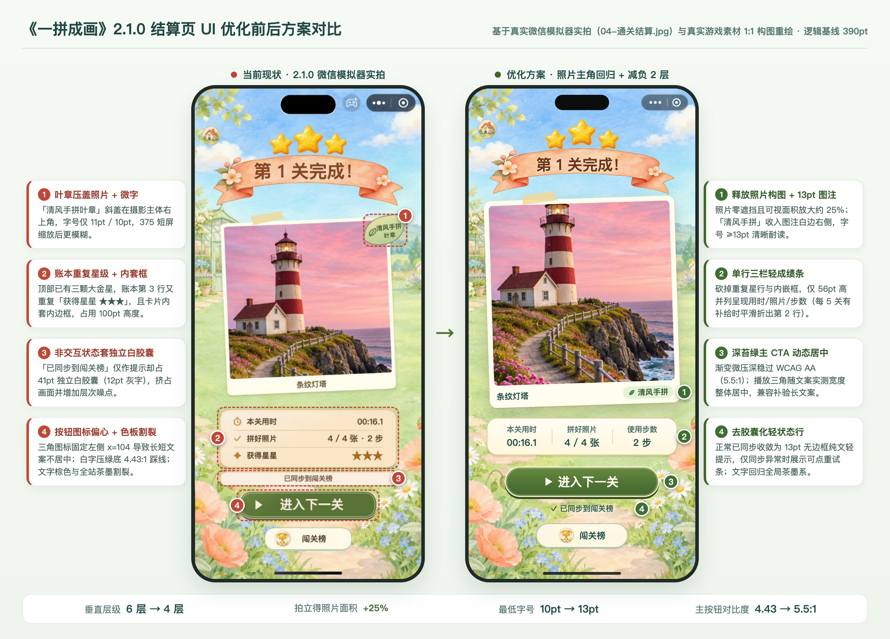
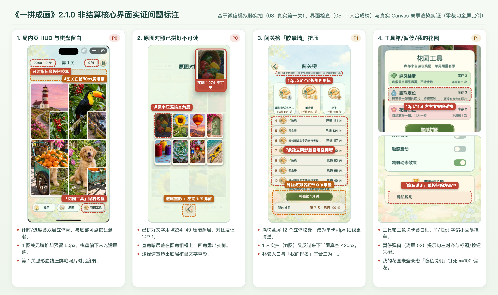

# 《一拼成画》2.1.0 单主线微信小游戏 UI 优化方案

> **评估对象**：《一拼成画》2.1.0 单主线版本（逻辑画布宽 `390pt`）  
> **设计基线**：坚守「清透绘本花园」「摄影照片为绝对主体」「仅连续闯关、不露总关数」三条产品原则，基于 `gemini-frontend-design`（v1.0.0）视觉与排版约束转译为手机 Canvas 实际尺度。  
> **本轮范围**：仅输出决策方案与对比参考图，**不修改产品代码、不执行部署**；不虚构任何用户留存或点击指标。

---

## 一、执行摘要与决策速览

当前 2.1.0 版本已完成单主线流程收敛，绘本花园氛围与高饱和实景照片的组合具备鲜明辨识度，首页扇形三图与局内 4×4 切拼构图方向正确。但结合 **22 张实拍/离屏渲染截图** 与源码逐行审计，当前界面在**高频页面视觉过载、只读信息与交互控件混淆、跨屏设计系统碎裂，以及一处致命可读性缺陷（原图对照已拼好文字对比度仅 `1.27:1`）** 上仍有显著提质空间。

建议聚焦以下 **5 项最高收益调整** 分三波落地：

| 序号 | 调整项 | 优先级 | 涉及源码 | 核心图上/实证症状 | 预期体验与质感收益 |
|---|---|---|---|---|---|
| **1** | **结算页减负与照片主角回归**（附前后对比图） | **P0** | `game/src/result.js` | 6 层垂直堆叠；账本重复「获得星星」且内套双框；「清风手拼叶章」压盖照片且 10/11pt 微字；独立同步白胶囊占位 | 垂直层级 `6层→4层`，拍立得照片展示面积放大约 **+25%**，短屏不挤压，消除 `<13pt` 微字 |
| **2** | **局内 HUD 去胶囊化、4 图关收回冗余留白与弹窗硬伤修复** | **P0** | `game/src/scenes.js` `game/src/board.js` | 顶部只读数据套按钮壳；4 图关无牌堆却预留 `50px` 空带；原图对照已拼好对比度 **1.27:1** 不可读；工具箱文案险碰撞 | 棋盘居中且短屏可视面积更大；消除原图对照致命可读性 Bug；顶栏「看」与底栏「点」职责分明 |
| **3** | **闯关榜去「胶囊栅栏」与少人/满榜双态自适应** | **P1** | `game/src/scenes.js` | 10 人满榜全屏 **12 个立体胶囊** 拥堵挤压；1 人实拍下半屏真空 `420px`；副标题 25 字仅 12pt；补验与排名双层堆叠 | 满榜清透度大幅提升、行高舒展；冷启动 1–3 人态不再像“页面未加载完”；底部操作收口为一 |
| **4** | **首页/准备页聚焦精修与「我的花园」对齐修正** | **P1** | `game/src/scenes.js` | 首页右下角游离块缺口露白且 `sin` 永动漂浮；准备页 3 行文案无主次；我的花园未登录态「隐私说明」偏左悬空 | 首屏更沉静省电且隐喻清晰；准备页省出 1 行给照片；我的花园卡片对齐与分割线统一 |
| **5** | **跨屏 Canvas 设计系统收敛（字号、色彩/Toast Token、动效节奏）** | **P1–P2** | `game/src/ui.js` `game/src/result.js` `game/src/board.js` `game/src/app.js` | 散落 **17 处字号值**（含 10 处 `<13pt`）；3 套割裂色板（Toast 为突兀冷紫灰）；主按钮 `4.43:1` 踩线；通关飞入 `880ms` 略拖沓 | 锁定「3 档正文 + 2 档标题/CTA」手机字号阶梯、全站零 `<13pt`；统一茶墨暖纸色系且对比度稳过 AA |

---

## 二、证据来源与审查边界

为避免把静态推断与真机事实混为一谈，本方案严格区分 **实拍证据、离屏 Canvas 实证、纯代码审查与动效数值审计** 四类来源：

| 证据类型 | 覆盖范围与来源 | 审查结论可信度说明 |
|---|---|---|
| **微信模拟器实拍**（590×1280，含灵动岛与微信胶囊） | `01-单主线首页.jpg`、`02-上线前进度补验入口.jpg`、`03-真实第一关.jpg`、`04-通关结算.jpg`、`05-真实闯关榜.jpg`、`06-本人进度.jpg`、`07-第二关验证.jpg`、`08-连续补验.jpg`、`09-第三关.jpg`、`10-第三关云端确认.jpg`、`11-最终真实闯关榜.jpg`（共 11 张） | **高**：真实反映微信胶囊安全区、底部 Home 条与实际渲染比例 |
| **多尺寸界面检查**（390×844 与 390×694 等效 375×667 短屏） | `01-首页.png`、`02-首关准备.png`、`03-闯关榜未连接.png`、`04-闯关榜空榜.png`、`05-闯关榜十人合成数据.png`、`06-结算与继续.png`、`07-短屏百关结算.png`（共 7 张） | **高**：实证了短屏压缩、十人满榜与未连接/空榜态布局 |
| **当前源码真实 Canvas 离屏实证**（已归档至项目内 `./ui-review/evidence/`） | [01-个人设置-本地档案.png](./ui-review/evidence/01-个人设置-本地档案.png)、[02-暂停-第100关.png](./ui-review/evidence/02-暂停-第100关.png)、[03-工具箱-第100关.png](./ui-review/evidence/03-工具箱-第100关.png)、[04-原图对照-第100关-合成已拼好一张.png](./ui-review/evidence/04-原图对照-第100关-合成已拼好一张.png)（共 4 张） | **高**：实证了非首页弹窗、已拼好遮罩对比度、以及第 100 关背景下局部可见的牌堆/晨雾/雏菊花扣 |
| **仅代码审查（缺无遮挡截图）** | 隐私首次授权弹窗（`privacy`）、隐私说明弹窗（`privacy-info`）、删除确认弹窗（`delete`）、启动加载与报错页（`loading`/`error`）、底部 Toast（`app.js:327`）、无弹窗遮挡的 5+ 图牌堆/晨雾/花扣/连消横幅完整局内 | **中（注明代码审查）**：基于精确坐标、色值与排版逻辑审查，实施后需补截图验收 |
| **动效数值审计（未做真机帧率/体感实测）** | 首页游离块 `2*Math.sin(app.now*1.4)`、场景淡出 `220ms`、拖拽回弹 `180ms`、移动 `180ms`、拨雾 `340ms`、通关飞入 `880ms`、补牌 `400ms`、融合脉冲 `320ms` | **基于源码参数**：静态图无法验证真机流畅度与拖动手感，需在真机实测阶段复核 |

---

## 三、`gemini-frontend-design`（v1.0.0）手机 Canvas 转译规则

直接生搬桌面 Web 规范（如 `clamp(3.5rem, 7.5vw, 8rem)`、桌面单行导航栏、滚动画布）会破坏微信小游戏竖屏体验。本方案将 skill 核心原则转译为 **390pt 逻辑画布（同步兼容 375×667 短屏，缩放比 `0.9615`）** 的可执行尺度：

| Skill v1.0.0 原始约束 | 手机 390pt Canvas 转译尺度（《一拼成画》） | 对应当前主要违背点 |
|---|---|---|
| **视觉方向与去装饰外壳**：让排版、比例、色彩与图像承载体验，禁止无意义胶囊/徽章与 card-in-card 嵌套框 | 仅对**可点击控件**使用立体表面（`U.surface`/`U.button`）；只读数据与状态提示采用留白、1px 细线或轻底色呈现，杜绝「大白卡套彩卡/套内框」 | 结算页大账本内套 `#fcf6d8` 框 + 状态白胶囊；局内顶栏只读数字套按钮胶囊；十人榜 12 胶囊墙；工具箱大白框套三色卡 |
| **严格 3 档正文阶梯 & 禁止 `<13px` 微字**：最多 2 套字体族（不用第 3 套等宽体），用字重与色阶区分层级，数值对齐 | 微信 Canvas 统一单一系统无衬线体（`PingFang SC` 回退），锁定 **3 档正文**：`16pt`（核心数值/开关主项）、`14pt`（常规正文/列表项/底栏按钮）、`13pt`（辅助说明/图注，全站最小字号底线）；标题 `22–24pt`、主 CTA `20–22pt`、结算丝带大字 `26–28pt` 归入 Hero 例外 | 源码出现 17 处字号值，含 10 处 `10/11/12pt` 微字（375 屏缩放后低至 `9.6px`） |
| **主题 Token 与 WCAG AA 对比度（`≥4.5:1`）**：清晰定义底面/主文/弱文/单一强调色，避免糊屏暗遮罩 | 收口为单一绘本茶墨暖纸 Token；常规正文与底面对比度 `≥4.5:1`，照片上的已完成标识用高对比奶白字+圆角轻暗层 | `photosModal` 已拼好文字仅 **`1.27:1`**；主绿按钮白字 `4.43:1` 踩线；Toast 为违和冷紫灰 `rgba(48,42,68,.94)` |
| **焦点构图与单一主 CTA**：让主体图像与留白主导视线，不堆底部 KPI 条，单屏只给一个最强行动点 | 首页/准备页/结算页每屏保持 **1 个深苔绿主 CTA**；最大视觉面积优先配给实景照片（拍立得或 4×4 棋盘），次要入口克制降噪 | 结算页 6 层堆叠把照片压小；4 图关预留 50px 空牌堆带；1 人闯关榜下半屏留白 420px |
| **克制动效（`140–240ms` ease-out）与禁止 idle bobbing**：尊重 `reduceMotion` | 去除首页游离拼图块持续 `sin` 永动上下浮动，改为入场轻落定格；交互微过渡收敛至 `160–220ms`，局内 `complete` 飞入由 `880ms` 收敛至 `640ms` | 首页右下角拼图块永动漂浮；局内通关飞入 `880ms` 叠加连消顿帧偏拖沓 |

---

## 四、5 项最高收益 UI 调整详案

### 调整 1（P0 · 最高收益）：通关结算页减负与照片焦点回归

**前后对比参考图**（左侧基于真实微信模拟器实拍 `04-通关结算.jpg`，右侧基于项目真实素材与 390pt 逻辑尺度 1:1 重绘）：

- **涉及文件**：`game/src/result.js`
- **图上症状**（实证：`04-通关结算.jpg`、`08-连续补验.jpg`、`10-第三关云端确认.jpg`、`06-结算与继续.png`、`07-短屏百关结算.png`）：
  1. **垂直 6 层拥挤**：顶部三金星 → 丝带 → 拍立得 → 3~4 行暖黄大账本（高 `100pt`，遇每 5 关补给再 `+24pt`）→ 独立白胶囊「已同步到闯关榜」（占 `41pt` 垂直槽位）→ 主 CTA → 底部「闯关榜」。
  2. **信息重复 + card-in-card**：顶部已展示 3 颗大图金星，账本第 3 行又重复「✦ 获得星星 ★★★」；账本内部又描了一层 `#fcf6d8` 内边框（`result.js:92`）。
  3. **叶章遮挡照片 + 极端微字**：无道具通关时右上角贴上硕大绿色「清风手拼叶章」，直接盖住灯塔天空、小松鼠枫叶等照片主体，且内部字号仅 `11pt`（「清风手拼」）与 `10pt`（「叶章」）（`result.js:57-58`）；短屏下拍立得底部图注也被压到 `11pt`（`result.js:69`）。
  4. **按钮重心失衡 + 色板割裂**：主 CTA 左侧播放三角写死 `x=104`（`result.js:113`），正常文案「进入下一关」时三角离文字过远，补验长文案「继续补验第 4 关」（`10-第三关云端确认.jpg`）字号被迫缩到 `18pt` 且贴紧三角；全页文字另起炉灶使用棕色 `ink='#53422b'`（`result.js:5`），与全局茶墨 `#234f49` 脱节。
- **体验影响**：结算页是每关必达的情绪高潮点，当前“系统结算表”压过了“刚刚拼好的摄影画作”本身；在 `375×667` 短屏遇第 5/10 关补给 + 同步状态条时，拍立得照片高度会被继续压缩超过 50pt。
- **具体怎么改**：
  1. **账本瘦身为单行三栏轻成绩条**：删除重复的「获得星星」行与 `#fcf6d8` 内嵌双框，改为高 `56pt`（短屏 `50pt`）的单层暖纸卡片，横向 3 等分并用 `1px` 淡金竖线分隔：`本关用时` / `拼好照片` / `使用步数`（上方标签 `13pt` `#51746d`，下方数值 `16pt` 加粗 `#234f49`）。仅在每 5 关触发 `rewardText` 时在底部平滑扩展 `28pt` 浅绿轻带显示「本关补给 · 花园工具 +X」。
  2. **释放 56–68pt 高度全部还给拍立得照片**：`layout()` 放宽照片上限至 `w≤312pt, h≤346pt`（短屏同步按比例放大），照片可视面积较现状提升约 **+25%**；底部白边高度固定为 `32pt`（短屏 `28pt`），图注锁定 `13pt` 以上。
  3. **重做「清风手拼」无道具荣誉呈现**：撤掉压在照片画面右上角的叶子贴纸，改为拍立得底部白边右侧的同行轻徽标（如左侧 `条纹灯塔`，右侧浅草绿微底 `🍃 清风手拼`，字号 `13pt`），照片主体 100% 完整无遮挡。
  4. **状态提示去胶囊化**：移除独立 `302×23` 白色状态胶囊（`result.js:104`）。正常态「✓ 已同步到闯关榜 / 进度已保存在本机」收敛为主按钮下方 `13pt` 无边框轻提示（带极淡奶白文字描边保证草地可读）；仅当 `result.error` 需重试时，渲染带暖红边框的可点击重试条。
  5. **主 CTA 图文动态居中 & 统一茶墨色系**：先用 `c.measureText(label).width` 计算文字宽，将播放三角与文案按 `icon(10) + gap(8) + textW` 整体居中，无论「进入下一关」还是「继续补验第 101 关」都视觉端正；正文字色回归全局 `P.ink (#234f49)` / `P.muted (#51746d)`，丝带标题加深至 `#6e3418`（对比度由 `4.48:1` 升至 **`5.8+:1`**）。
- **可验证验收标准**：
  - `390×844`（含微信胶囊）与 `375×667` 短屏下，常规关与第 5/10 关（带补给）结算页均**无任何元素重叠或裁切**；
  - 结算页拍立得有效画面高度较 2.1.0 提升 `≥ 35pt`，且右上角零贴纸遮挡；
  - 页面内所有文字字号 `≥ 13pt`；
  - 主按钮在 5 字（「进入下一关」）与 8 字（「继续补验第 101 关」）下，图标+文字整体水平偏移误差 `≤ 1pt`。

---

### 调整 2（P0 · 核心主战场 + 致命可读性修复）：局内 HUD 去胶囊化、4 图关收回冗余空带与弹窗硬伤修复

**多屏实证标注图**（整合微信模拟器实拍、十人合成榜与 `./ui-review/evidence/` 真实离屏渲染证据，项目内完全自包含）：

> 原始离屏大图留档：[01-个人设置](./ui-review/evidence/01-个人设置-本地档案.png) · [02-暂停](./ui-review/evidence/02-暂停-第100关.png) · [03-工具箱](./ui-review/evidence/03-工具箱-第100关.png) · [04-原图对照](./ui-review/evidence/04-原图对照-第100关-合成已拼好一张.png)

- **涉及文件**：`game/src/scenes.js`（`game` / `photosModal` / `gardenTools` / `modal`）、`game/src/board.js`（`layout` / `guide`）
- **图上症状**：
  1. **顶栏只读信息误套按钮壳**（实拍 `03/07/09`）：顶部 `00:00 · 0 步` 和 `0/4` 使用与底部按钮完全一致的立体双阴影白胶囊（`U.surface`），既混淆“可点击/不可点击”心智，又切碎顶栏。
  2. **4 图关白白预留 `50px` 顶部牌堆空带**（实拍 `03/07/09` + 代码实证 `board.js:7, 207`）：`board.js:layout` 无条件扣除 `deckGap = deckHeight + 10`（长屏 `50pt` / 短屏 `42pt`），但 `deck()` 在 `photoIds.length <= 4` 时直接 `return`，导致所有 4 图关卡棋盘上方出现明显大空带，棋盘重心偏下。
  3. **底栏按钮文字偏移 + 引导虚线对比度弱**（实拍 `03/07/09`）：底部 3 个等宽 `108pt` 按钮将文字固定在 `x+67`，2 字的「提示/原图」显左空，4 字的「花园工具」右侧紧贴边框；第 1 关金色虚线提示压在高饱和红果/绿叶/海岸照片上辨识度偏低。
  4. **原图对照已拼好文字致命不可读**（离屏实拍 `evidence/04-原图对照-第100关-合成已拼好一张.png` + 代码 `scenes.js:210`）：已拼好照片叠了 `rgba(31,42,33,.53)` 暗遮罩，却仍用深绿 `P.ink (#234f49)` 写「✓ 已拼好」，实测对比度仅 **`1.27:1`**（肉眼几乎消失）；遮罩圆角为 `0` 导致直角暗角超出圆角照片；整页浅绿遮罩 `rgba(235,247,229,.92)` 透出底下棋盘与 HUD 重影；关闭图标错用返回左箭头 `back`。
  5. **暂停与工具箱弹窗布局瑕疵**（离屏实拍 `evidence/02-暂停`、`evidence/03-工具箱`）：暂停页说明句「局面已保存，可以随时继续。」孤立左对齐（`U.wrap` 默认左对齐），与居中标题/主按钮严重失衡，底排 3 圆形图标无文字标签；工具箱 3 张卡片用了绿/灰/粉三色实心块套在白卡片内（card-in-card），`12pt` 说明与 `11pt` 右侧不可用原因（「照亮同一张图的四片，持续五秒」与「还没有齐全的四片」）间距过窄险些相撞。
- **体验影响**：局内占据玩家 90%+ 游玩时长，原图对照「已拼好」不可读直接影响多图关卡查图效率；4 图关浪费的 50pt 高度直接缩小了短屏棋盘的照片清晰度。
- **具体怎么改**：
  1. **顶栏去胶囊化**：移除 `00:00 · 0 步` 与 `0/4` 的 `U.surface` 立体底壳，改为干净的三段无壳轻排版（左 `14pt` 茶墨色时间步数、中 `20pt` 加粗关数、右 `14pt` 加粗进度 `0/4`），仅保留最右侧圆形「暂停」作为顶栏唯一可点击按钮。
  2. **按需预留牌堆高度**：`board.js:layout` 改为 `const hasDeck = app.game.level.photoIds.length > 4; const deckGap = hasDeck ? deckHeight + 10 : 0;`。4 图关立即收回 42–50pt 顶部空带，棋盘在顶栏与底栏间真正视觉居中，且在 `375×667` 短屏下棋盘宽度可自然放大。
  3. **底栏图文动态居中 + 引导弧线描边护航**：底部三按钮以 `iconW + 6 + textW` 动态居中排布（或将底栏 3 按钮放宽至 `112pt`、间距 `10pt` 给「花园工具」留足呼吸边）；第 1 关及提示弧线底层加 `5.5pt` `rgba(35,79,73,.42)` 柔和暗影底线，确保在任何明亮照片上清晰可见。
  4. **立即修复原图对照 / 暂停 / 工具箱弹窗**：
     - **原图对照**：背景遮罩提纯至 `rgba(244,251,240,.97)` 消除底层重影；已拼好暗层改圆角 `r=9` 严丝合缝贴合照片，居中文字改奶白 `#fffdf3` 加粗 `14pt`（或配小奶白对勾胶囊，对比度 **`>7.5:1`**）；底部按钮改为语义明确的「返回拼图」轻按钮或 `×` 关闭控件。
     - **暂停弹窗**：说明文案改为水平居中；底部三枚圆形图标下方各补 `13pt` 短标签（「重玩」「提示」「首页」），消除盲猜成本。
     - **工具箱弹窗**：取消三张彩底硬套框，统一清透奶白行底 + 左侧图标色标区分，不可用态以整体 `0.58` 透明 + 右侧清晰的暖灰状态词区分；左文限宽防撞并将详情/状态字号统一提升至 `13pt`（详情精简为 `吹散至多 2 片晨雾 · 不计步`、`照亮同图 4 片 · 持续 5 秒`、`自动归位 1 组 · 计 1 步`）。
- **可验证验收标准**：
  - 离屏复拍原图对照（含已拼好状态）：「✓ 已拼好」对比度实测 `≥ 7:1`，四角无直角暗刺，背景无棋盘重影；
  - 4 图关（第 1–3 关）棋盘上下留白差 `≤ 6pt`，8 图关（如第 100 关）牌堆与棋盘间距正常；
  - 底栏「花园工具」左右内边距 `≥ 10pt`；工具箱 3 行左右文案最小间距 `≥ 16pt` 且无 `<13pt` 文字；暂停页文案视觉居中且三图标均带可读标签。

---

### 调整 3（P1 · 社交与留存触点）：闯关榜去「胶囊栅栏」与少人/满榜双态自适应

- **涉及文件**：`game/src/scenes.js`（`podium` / `ranks`）
- **图上症状**（实证：`02-上线前进度补验入口.jpg`、`05/06/11-真实闯关榜.jpg`、`03-未连接.png`、`04-空榜.png`、`05-闯关榜十人合成数据.png`）：
  1. **满榜 10 人「胶囊墙」拥堵**：第 4–10 名每行都是独立的双阴影圆角白胶囊（间距仅 `4pt`），叠加顶部 3 张领奖台 + 底部补验按钮 + 底部「我的排名」，一屏塞满 **12 个厚边框胶囊**；行高压缩、昵称缩至 `13pt`，领奖台长昵称几乎贴边。
  2. **冷启动 1 人态下半屏严重真空**：真实榜 `05/06/11` 仅 1 位玩家时，居中孤悬一张宽 `106pt` 的小卡片，下方露出超过 `420pt` 的大片空白背景，极易误判为数据未加载。
  3. **空榜 + 补验上下断层**：`02-上线前进度补验入口.jpg` 中间写「还没有通关记录」，行动按钮「补验第 1 关」却掉到屏幕最底端，视觉路径割裂。
  4. **规则副标题过长且过小**：`按已通关数排名，同关先获验证者居前，可使用花园工具` 长达 25 字仅 `12pt`，带有内部规则口径感；底部「旧存档只有成绩，重新通关即可上榜」同为 `12pt` 且与「我的排名」双层堆叠。
- **体验影响**：新上线早期（1–3 人）与成熟期（满 10 人）呈现两个极端——前者显空洞冷清，后者显拥挤廉价。
- **具体怎么改**：
  1. **第 4–10 名改为单张清透列表卡 + `1px` 细线**：将 7 条独立阴影胶囊合并为 **1 张完整奶白圆角容器**（`x=18, w=354`），行间用 `1px` `#dce7d8` 淡草绿细线分隔；当前玩家行用柔和暖黄 `#fff8e2` 底色块整行高亮。瞬间削减 6 组阴影边框噪点，每行高度放宽至 `≥44pt`，昵称升至 `14pt`。
  2. **少人态（1–3 人）自适应构图**：
     - 仅 1 人时：改为居中放大的优雅冠军荣誉卡（宽 `256pt`，头像 `r=40`，清晰展示昵称与「已通 X 关」），卡片下方紧接轻量虚位提示（「继续向前闯关，或邀好友同游花园」）与直接行动入口（无补验时为「继续闯关」），彻底消除 `420pt` 视觉真空。
     - 2–3 人时：适度加宽领奖台卡（2 人并排各 `148pt`，3 人各 `110pt` 并给昵称预留 `10pt` 左右内边距）。
  3. **副标题瘦身 + 底部单卡整合**：
     - 顶部副标题精简为 `按连续通关数排名 · 同关先达者居前`（`13pt`，17 字清爽居中，去掉冗长的「可使用花园工具」）。
     - 底部将「我的排名」与「旧存档补验」合二为一为单张底部状态卡：常规态单行展示 `我的排名 | 第 X 名 · 已通 Y 关`；需要补验时在同一卡片内下延一行展示 `13pt` 简明提示 + 右侧/底部轻量「补验第 X 关」按钮；若为空榜且需补验（如 `02` 图），直接把「补验第 1 关」上提至中心空状态区主按钮位，解决上下断层。
- **可验证验收标准**：
  - 分别验证 `0 人（无补验）`、`0 人（需补验）`、`1 人`、`3 人`、`10 人（含长昵称 + 需补验）` 5 种状态在 `390×844` 与 `375×667` 下的截图；
  - 10 人满榜下列表区仅为 1 个外容器 + 1px 细线，无 7 层独立胶囊堆叠，每行高度 `≥ 40pt`（390×844 下 `≥ 44pt`）；
  - 1 人态下半屏不再出现无信息的大面积空洞；全页文字 `≥ 13pt`。

---

### 调整 4（P1 · 第一印象与克制动效）：首页与准备页聚焦精修 + 「我的花园」对齐修正

- **涉及文件**：`game/src/scenes.js`（`homeArt` / `home` / `intro` / `profile`）
- **图上症状**（实证：`01-单主线首页.jpg`、`01-首页.png`、`02-首关准备.png`、`evidence/01-个人设置-本地档案.png`）：
  1. **首页游离块缺口露白 + 永动漂浮**：`01-单主线首页.jpg` 中，中心向日葵右下角拼图块移开后，后方底板露出无阴影层次的平白奶黄直角缺口；同时源码 `scenes.js:40` 让该块持续按 `2*Math.sin(app.now*1.4)` 做永动上下漂浮（违背 skill 禁止 idle bobbing 循环原则，且微信小游戏持续重绘无意义耗电）。
  2. **首页次要入口与花丛争抢视线**：底部「闯关榜 / 我的」两个高对比实心金白胶囊正压在背景色彩最艳丽的橙色罂粟花丛上方，略分散主 CTA 注意力。
  3. **首关准备页文字层次平淡**：`02-首关准备.png` 底部三行文案裸浮在花草背景上，第 1 行「4 张照片」与第 2 行玩法引导同为 `15pt` 同色同重，缺少主次区分。
  4. **「我的花园」对齐与分割线缺陷**：离屏图 `evidence/01-个人设置-本地档案.png` 中，未登录时没有「删除记录」，但「隐私说明」仍写死在左侧 `x=100`（`scenes.js:200`），右侧留出大半空白；4 个开关之间的分割线颜色 `rgba(244,228,193,.22)` 在 `#f5fff5` 底面上肉眼完全不可见（`scenes.js:191`）。
- **具体怎么改**：
  1. **首页隐喻清晰化与动效收敛**：为主图底板右下角缺口绘制浅米灰内凹虚线框（`rgba(166,154,124,.45)`，虚线 `[4,4]`），一眼建立「此角待拼回」的视觉对应；**取消持续正弦永动漂浮**，改为进入首页时一次性 `240ms ease-out` 轻落定格（尊重 `reduceMotion`）。底部草丛上沿叠一层极柔和的底部淡奶雾渐隐（`height: 150pt`，alpha `0→0.32`），轻托起主 CTA 与两个次要入口，压低底部花丛视觉噪点。
  2. **准备页压缩为 2 行清晰层级**：将「`X 张照片`」与「`三星目标 Y 步`」合并为上方 1 行 `13pt` 弱色元信息（`4 张照片 · 三星目标 3 步`，带晨雾/花扣时自动拼入），将玩法提示句作为下方唯一 `15–16pt` 加粗主引导行，并配极淡奶白柔底衬（或文字外微光）确保在花草上清晰可读，同时腾出 `24pt` 高度给 4–8 张照片预览矩阵。
  3. **修复「我的花园」布局**：`scenes.js:200` 根据 `Boolean(app.profile)` 动态决定「隐私说明」坐标——无「删除记录」时居中 `x=195`，有「删除记录」时左右对称排布；将开关分割线统一改为 `#d5dfca`（与下卡片分割线保持一致）。
- **可验证验收标准**：
  - 首页静止 3 秒后，右下角游离拼图块保持稳定定格（不再持续上下跳动），且缺口槽位清晰可辨；
  - 准备页 4 图与 8 图关卡下，说明区严格为 2 行，主次分明且与底部按钮无碰撞；
  - 「我的花园」未登录态「隐私说明」严格水平居中，登录态与「删除记录」左右对称；开关 3 条分割线肉眼清晰可见。

---

### 调整 5（P1–P2 · 跨屏设计系统底座）：字号阶梯、色彩/Toast Token 与动效节奏统一

- **涉及文件**：`game/src/ui.js`、`game/src/result.js`、`game/src/board.js`、`game/src/app.js`
- **症状（源码全量审计 + WCAG 对比度实测）**：
  1. **17 处散乱字号 + 10 处 `<13pt` 微字**：当前 5 个 UI 文件中混用 `10, 11, 12, 13, 14, 15, 16, 17, 18, 20, 21, 22, 24, 25, 26, 29, 31` 共 17 种字号，其中 10 处低于 `13pt`（叶章 `10/11pt`、短屏图注 `11pt`、牌堆角标 `11pt`、工具箱剩余次数 `11pt`、榜单副标/补验说明/结算状态/工具详情/连消横幅/Toast 均 `12pt`）。
  2. **三套割裂色板 + 局部对比度踩线**：`ui.js` 茶墨系 vs `result.js` 暖棕系 vs `app.js:327` Toast 冷紫灰 `rgba(48,42,68,.94)`（唯一纯代码审查确认的突兀暗色块）；实测主绿 CTA 白字 `#fffdf3` 压中段绿 `#5b813e` 对比度仅 **`4.43:1`**（踩 4.5:1 红线）；丝带标题 `#854325` 压 `#f5be93` 仅 **`4.48:1`**。
  3. **动效时长偏长（代码审查）**：`app.js:214` 定义 `complete: 0.88s`（`880ms`），当单步连消多图时叠加 `45ms` 顿帧与后续 `fall(200ms) + refill(400ms)`，整段等待接近 `1.5s`，在连续闯关节奏下略显拖沓；牌堆剩余数角标仅 `11pt`（`board.js:218`）。
- **具体怎么改**：
  1. **落地 390pt 手机 Canvas 统一字号 Token（写入 `ui.js` 常量）**：
     - **正文严格 3 档**：`TEXT_LG = 16`（核心数值/开关项/工具名）、`TEXT_MD = 14`（常规正文/榜单行/底栏操作）、`TEXT_SM = 13`（辅助说明/图注/角标/Toast，**全项目零 `<13pt`**）；
     - **标题与主控 2 档（Hero 例外）**：`TITLE = 22~24`（页眉/弹窗标题）、`CTA = 20~22`（深绿主按钮），结算丝带大字 `26~28`（短屏 `24`）。
     - 牌堆角标圆半径由 `9pt` 略增至 `10pt`，字号升至 `13pt`（实测 1–2 位数完全可容下）。
  2. **统一全站色板 Token 与对比度达标**：
     - `buttonPlate` 主绿渐变微压深为 `['#688940', '#4f7434', '#43662c']`（白字 `#fffdf3` 对比度升至 **`5.5:1`**，同时更贴合沉稳绘本草木绿）；
     - 结算丝带字色加深至 `#6e3418`（对比度 **`5.8:1`**）；
     - `app.js:327` Toast 替换为绘本暖深苔墨 `rgba(35,79,73,.92)` + `1px` 淡奶金描边 + `13pt` `#fffdf3` 字（支持双行防溢出）。
  3. **校准动效参数（对应 skill 140–240ms 干脆区间）**：
     - 场景淡出 `0.22s → 0.18s`，单步 `move: 0.16s`、`fall: 0.18s`、`dragRelease: 0.16s`；
     - 通关飞入 `complete: 0.88s → 0.64s`（`refill: 0.34s`），让连续消图既保留礼花飞入的仪式感，又不打断手速心流；所有动效继续严格服从 `reduceMotion`。
- **可验证验收标准**：
  - 静态扫描 `game/src/{scenes,result,board,ui,app}.js`，`U.text / U.title / U.wrap` 传入字号集合不超过预设 Token 表，且**不存在 `< 13` 的字号调用**；
  - 所有常规文本/按钮对比度计算值 `≥ 4.5:1`（大标题/图标 `≥ 3:1`）；
  - 触发 Toast（如点击雏菊花扣锁住的块、网络报错）时视觉与绘本花园风格一致且无文字截断。

---

## 五、建议实施顺序

按 **「先修硬伤与最高频收益 → 再提全局清透度 → 最后打磨细节与真机手感」** 分三波推进，每波可独立回归截图验收：

1. **Wave 1（P0 · 止血 + 最高回报，预计最小改动最高感知）**
   - 先落 **调整 5** 中的基础色板/字号常量表与主按钮对比度微调（`ui.js`）；
   - 同步完成 **调整 2 的致命修复**（原图对照已拼好 `1.27:1` 改为奶白圆角高对比 + 消重影，以及 `board.js:layout` 4 图关收回 `50px` 牌堆空带）；
   - 完成 **调整 1**（结算页瘦身重构，放大拍立得主角，移走压图叶章与独立同步白胶囊）。
   - *Wave 1 验收门禁*：`390×844` 与 `375×667` 短屏下重跑第 1 关、第 5 关（带补给）、第 100 关结算及原图对照截图。
2. **Wave 2（P1 · 全站去「胶囊化」与状态补齐）**
   - 完成 **调整 2 剩余项**（局内顶栏去胶囊化、底栏动态居中、引导虚线护航、暂停居中+图标标签、工具箱防撞精修）；
   - 完成 **调整 3**（闯关榜 4–10 名单卡+1px 细线、1–3 人自适应、底部补验整合）；
   - 完成 **调整 4**（首页去永动+缺口内槽、准备页 2 行层级、我的花园居中对齐与分割线统一）。
   - *Wave 2 验收门禁*：补齐 0/1/3/10 人榜单、首页、准备页、工具箱、暂停、我的花园（登录/未登录）全套对比图。
3. **Wave 3（P2 · 动效手感与真机验证）**
   - 完成 **调整 5 剩余项**（Toast 换肤、连消/飞入时长微调、`privacy`/`delete`/`error` 弹窗字号对齐）；
   - 在 iOS（灵动岛长屏 + SE/8 短屏）与 Android 微信真机环境做手势拖拽、连消帧率与云同步弱网实测。

---

## 六、假设、未完成真机验证与设计取舍

### 1. 本轮前提假设与未验证项
- **未做真机实测**：本次评估基于微信开发者工具模拟器实拍（590×1280）、桌面浏览器多尺寸截图（390×844 / 390×694）及 Canvas 离屏渲染图。**iOS / Android 微信真机的系统字体基线偏移、刘海/挖孔与微信右上角胶囊实时高度、高刷屏与中低端安卓机的拖拽/飞入帧率、以及触感震动与动画节奏的配合**，均未在本轮实测，须在 Wave 3 真机补齐。
- **缺截图页面以代码审查为准**：`privacy`、`privacy-info`、`delete`、`loading`、`error`、底部 Toast 及无遮挡完整版 8 图带牌堆/晨雾/花扣局内，目前主要依据源码参数评估，落地后需补截实图核验。
- **不虚构业务指标**：本方案所有收益描述均立足可测的版面比例、对比度、字号底线与视觉层级变化，不编造“预计留存提升 X%”等未经 A/B 实验证实的数据。

### 2. 关键设计取舍说明
- **保留拍立得微倾角与纸胶带，而非改成呆板方卡**：绘本花园的核心温度来自“手作相册感”，减负砍掉的是重复账本行、内套框与无意义胶囊，而非手作绘本灵魂。
- **保留「清风手拼」荣誉，但迁出照片主体**：无道具手拼是高阶玩家的情绪正向反馈，直接删掉会削弱成就感；迁至拍立得底部图注同行右侧，既保住了荣誉记忆，又把 100% 完整的摄影画作还给玩家。
- **闯关榜 1 人冷启动态不做假人/机器人占位**：坚守真实连续闯关与诚实排名心智，通过放大的居中荣誉卡 + 轻量留白鼓励提示化解视觉空洞，而不造假数据充数。
- **不新增总关数或章节进度条**：严格遵守「只连续闯关、不露总关数」设定，所有准备页、局内、结算页与榜单文案均只呈现当前关号或已通连续关数。
