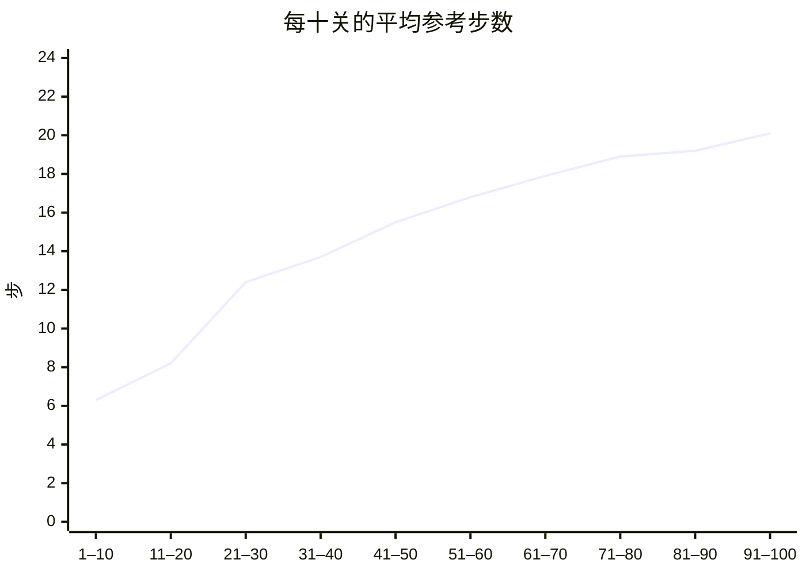

# 一拼成画 · 百关主线设计

## 玩家路径

首页只有一个继续闯关的主要入口，显示当前关号。完成一关即可进入下一关。首次发行明确编排第 1 至 100 关，客户端界面只展示当前关号。第 101 关开始沿同一主线继续发牌。

## 设计依据

King 的关卡设计师 Jeremy Kang 在 GDC Europe 2016 的讲义把节奏拆成事件的次序、频率和强度，把目标数、步数、星级、颜色数及阻挡数量作为可分别调节的参数。本作据此分别控制照片数、库存列、云片数与花扣数。首次教花扣时收回到六张照片，首次教双扣时收掉全部云片。[《Level Design Saga》，第 46、55、56 和 65 页](https://media.gdcvault.com/gdceurope2016/presentations/KANG_Jeremy_LevelDesignSaga.pdf)

Candy Crush 负责人 Todd Green 在访谈中说明，团队会安排较难关后接较易关，并结合玩家反映、通过率和重排情况调整。这里采用分段上升、段内反复练习和回缓的节奏。拼图没有失败倒计时，后续真人测试应关注每关完成率、主动退出率、提示使用率和实际步数分布。[美联社对 Todd Green 的采访](https://apnews.com/article/547254aaa06bf026df5b41458ac62dcc)

## 十段节奏

参考步数取自当前提示算法。每一手可按共享规则重放。该量反映路径长度，玩家找物、识别纹理与练习成本仍需靠真人试玩校准。超过二星门槛仍可过关。每段内部允许平关及缓冲关，后三段每十关均值的差距逐步缩小。

| 关段 | 重点 | 参考步数范围 | 均值 | 玩家体验 |
|---|---|---:|---:|---|
| 1–10 | 基础交换 | 2–8 | 6.3 | 先找到三个已相连的角。首关两步拼成四图，3、4 关连续练习六步规模的交换。 |
| 11–20 | 晨雾入门 | 6–10 | 8.2 | 让第 12 关比第 11 关短，首遇云片时仍只有四图。第 14、16 关回到纯照片。 |
| 21–30 | 补牌入门 | 10–15 | 12.4 | 第 21–25 关连续六图，两列共八张备用片，没有云片和花扣。第 26 关进入八图四列，第 28 关回到六图。 |
| 31–40 | 花扣入门 | 11–16 | 13.7 | 第 31 关收至六图，围绕一枚花扣拼合。其后在六图单扣、六图无障碍和八图补牌间转换。 |
| 41–50 | 晨雾与补牌 | 13–18 | 15.5 | 组合云片和补牌。第 43、48 关回到六图单扣，把注意力从选图切回摆位。 |
| 51–60 | 单扣与云片 | 13–19 | 16.8 | 引入单扣与云片交织。第 53、58 关都是六图缓冲。第 59、60 关同档练习。 |
| 61–70 | 三云片布局 | 14–20 | 17.9 | 先用三张云片增加计划深度。第 63、68 关只保留单扣，降低同时追踪的目标数。 |
| 71–80 | 双扣布局 | 14–21 | 18.9 | 第 71 关引入双扣时移除云片，先学如何挑选花扣。练过双扣再穿插单扣和晨雾。 |
| 81–90 | 双扣与晨雾 | 14–23 | 19.2 | 第 81 关以 18 步初见双扣与四云片，第 87 关达到 23 步峰值，第 88 关收至六图、14 步恢复。 |
| 91–100 | 熟练组合 | 17–23 | 20.1 | 把成熟机制组排成几段平关，第 93、98 关回缓。通关后按钮和其他关一样进入下一关。 |

## 逐关配置

图数是本局要拼好的照片数。补牌列是开局有库存的列数。参考步数相同的关仍有独立照片和棋面。三星门槛取参考步数的 1.2 倍向上取整，二星为 1.6 倍向上取整。

| 关 | 图数 | 补牌列 | 云片 | 花扣 | 参考步数 | 三星 / 二星 | 节奏 |
|---:|---:|---:|---:|---:|---:|---:|---|
| 1 | 4 | 0 | 0 | 0 | 2 | 3 / 4 | 两步初拼 |
| 2 | 4 | 0 | 0 | 0 | 5 | 6 / 8 | 横竖连块 |
| 3 | 4 | 0 | 0 | 0 | 6 | 8 / 10 | 增加练习量 |
| 4 | 4 | 0 | 0 | 0 | 6 | 8 / 10 | 同档巩固 |
| 5 | 4 | 0 | 0 | 0 | 8 | 10 / 13 | 满盘整组交换 |
| 6 | 4 | 0 | 0 | 0 | 6 | 8 / 10 | 调整练习量 |
| 7 | 4 | 0 | 0 | 0 | 8 | 10 / 13 | 增加练习量 |
| 8 | 4 | 0 | 0 | 0 | 6 | 8 / 10 | 调整练习量 |
| 9 | 4 | 0 | 0 | 0 | 8 | 10 / 13 | 增加练习量 |
| 10 | 4 | 0 | 0 | 0 | 8 | 10 / 13 | 同档巩固 |
| 11 | 4 | 0 | 0 | 0 | 8 | 10 / 13 | 同档巩固 |
| 12 | 4 | 0 | 2 | 0 | 6 | 8 / 10 | 初见晨雾 |
| 13 | 4 | 0 | 2 | 0 | 8 | 10 / 13 | 增加练习量 |
| 14 | 4 | 0 | 0 | 0 | 7 | 9 / 12 | 调整练习量 |
| 15 | 4 | 0 | 2 | 0 | 9 | 11 / 15 | 增加练习量 |
| 16 | 4 | 0 | 0 | 0 | 8 | 10 / 13 | 调整练习量 |
| 17 | 4 | 0 | 2 | 0 | 9 | 11 / 15 | 增加练习量 |
| 18 | 4 | 0 | 0 | 0 | 8 | 10 / 13 | 调整练习量 |
| 19 | 4 | 0 | 2 | 0 | 9 | 11 / 15 | 增加练习量 |
| 20 | 4 | 0 | 2 | 0 | 10 | 12 / 16 | 增加练习量 |
| 21 | 6 | 2 | 0 | 0 | 10 | 12 / 16 | 初见两列补牌 |
| 22 | 6 | 2 | 0 | 0 | 10 | 12 / 16 | 同档巩固 |
| 23 | 6 | 2 | 0 | 0 | 11 | 14 / 18 | 增加练习量 |
| 24 | 6 | 2 | 0 | 0 | 11 | 14 / 18 | 同档巩固 |
| 25 | 6 | 2 | 0 | 0 | 12 | 15 / 20 | 增加练习量 |
| 26 | 8 | 4 | 0 | 0 | 14 | 17 / 23 | 八图四列补牌 |
| 27 | 8 | 4 | 0 | 0 | 14 | 17 / 23 | 同档巩固 |
| 28 | 6 | 2 | 0 | 0 | 12 | 15 / 20 | 调整练习量 |
| 29 | 8 | 4 | 0 | 0 | 15 | 18 / 24 | 增加练习量 |
| 30 | 8 | 4 | 0 | 0 | 15 | 18 / 24 | 同档巩固 |
| 31 | 6 | 2 | 0 | 1 | 11 | 14 / 18 | 初见雏菊花扣 |
| 32 | 6 | 2 | 0 | 1 | 12 | 15 / 20 | 增加练习量 |
| 33 | 6 | 2 | 0 | 0 | 12 | 15 / 20 | 同档巩固 |
| 34 | 6 | 2 | 0 | 1 | 13 | 16 / 21 | 增加练习量 |
| 35 | 8 | 4 | 0 | 0 | 15 | 18 / 24 | 增加练习量 |
| 36 | 6 | 2 | 0 | 1 | 13 | 16 / 21 | 调整练习量 |
| 37 | 8 | 4 | 0 | 0 | 16 | 20 / 26 | 增加练习量 |
| 38 | 6 | 2 | 0 | 1 | 14 | 17 / 23 | 调整练习量 |
| 39 | 8 | 4 | 0 | 0 | 16 | 20 / 26 | 增加练习量 |
| 40 | 6 | 2 | 0 | 1 | 15 | 18 / 24 | 调整练习量 |
| 41 | 8 | 4 | 2 | 0 | 15 | 18 / 24 | 八图两云 |
| 42 | 8 | 4 | 2 | 0 | 15 | 18 / 24 | 同档巩固 |
| 43 | 6 | 2 | 0 | 1 | 13 | 16 / 21 | 调整练习量 |
| 44 | 8 | 4 | 2 | 0 | 16 | 20 / 26 | 增加练习量 |
| 45 | 8 | 4 | 0 | 0 | 15 | 18 / 24 | 调整练习量 |
| 46 | 8 | 4 | 3 | 0 | 17 | 21 / 28 | 增加练习量 |
| 47 | 8 | 4 | 2 | 0 | 16 | 20 / 26 | 调整练习量 |
| 48 | 6 | 2 | 0 | 1 | 13 | 16 / 21 | 回缓 |
| 49 | 8 | 4 | 3 | 0 | 18 | 22 / 29 | 增加练习量 |
| 50 | 8 | 4 | 2 | 0 | 17 | 21 / 28 | 调整练习量 |
| 51 | 8 | 4 | 2 | 1 | 18 | 22 / 29 | 单扣两云 |
| 52 | 8 | 4 | 2 | 1 | 17 | 21 / 28 | 调整练习量 |
| 53 | 6 | 2 | 0 | 1 | 13 | 16 / 21 | 回缓 |
| 54 | 8 | 4 | 2 | 1 | 18 | 22 / 29 | 增加练习量 |
| 55 | 8 | 4 | 2 | 0 | 16 | 20 / 26 | 调整练习量 |
| 56 | 8 | 4 | 2 | 1 | 18 | 22 / 29 | 增加练习量 |
| 57 | 8 | 4 | 3 | 0 | 17 | 21 / 28 | 调整练习量 |
| 58 | 6 | 2 | 0 | 1 | 14 | 17 / 23 | 回缓 |
| 59 | 8 | 4 | 2 | 1 | 19 | 23 / 31 | 增加练习量 |
| 60 | 8 | 4 | 2 | 1 | 18 | 22 / 29 | 调整练习量 |
| 61 | 8 | 4 | 3 | 1 | 20 | 24 / 32 | 单扣三云 |
| 62 | 8 | 4 | 2 | 1 | 18 | 22 / 29 | 调整练习量 |
| 63 | 6 | 2 | 0 | 1 | 14 | 17 / 23 | 回缓 |
| 64 | 8 | 4 | 3 | 1 | 19 | 23 / 31 | 增加练习量 |
| 65 | 8 | 4 | 2 | 0 | 16 | 20 / 26 | 回缓 |
| 66 | 8 | 4 | 3 | 1 | 20 | 24 / 32 | 增加练习量 |
| 67 | 8 | 4 | 2 | 1 | 18 | 22 / 29 | 调整练习量 |
| 68 | 6 | 2 | 0 | 1 | 14 | 17 / 23 | 回缓 |
| 69 | 8 | 4 | 3 | 1 | 20 | 24 / 32 | 增加练习量 |
| 70 | 8 | 4 | 3 | 1 | 20 | 24 / 32 | 同档巩固 |
| 71 | 8 | 4 | 0 | 2 | 21 | 26 / 34 | 先解哪枚花扣 |
| 72 | 8 | 4 | 0 | 2 | 20 | 24 / 32 | 调整练习量 |
| 73 | 6 | 2 | 0 | 1 | 14 | 17 / 23 | 回缓 |
| 74 | 8 | 4 | 0 | 2 | 20 | 24 / 32 | 增加练习量 |
| 75 | 8 | 4 | 2 | 1 | 18 | 22 / 29 | 调整练习量 |
| 76 | 8 | 4 | 3 | 1 | 19 | 23 / 31 | 增加练习量 |
| 77 | 8 | 4 | 0 | 2 | 21 | 26 / 34 | 增加练习量 |
| 78 | 6 | 2 | 0 | 1 | 14 | 17 / 23 | 回缓 |
| 79 | 8 | 4 | 0 | 2 | 21 | 26 / 34 | 增加练习量 |
| 80 | 8 | 4 | 0 | 2 | 21 | 26 / 34 | 同档巩固 |
| 81 | 8 | 4 | 4 | 2 | 18 | 22 / 29 | 双扣四云 |
| 82 | 8 | 4 | 3 | 1 | 19 | 23 / 31 | 增加练习量 |
| 83 | 8 | 4 | 2 | 1 | 17 | 21 / 28 | 调整练习量 |
| 84 | 8 | 4 | 4 | 2 | 20 | 24 / 32 | 增加练习量 |
| 85 | 8 | 4 | 0 | 2 | 21 | 26 / 34 | 增加练习量 |
| 86 | 8 | 4 | 3 | 1 | 19 | 23 / 31 | 调整练习量 |
| 87 | 8 | 4 | 4 | 2 | 23 | 28 / 37 | 增加练习量 |
| 88 | 6 | 2 | 0 | 1 | 14 | 17 / 23 | 回缓 |
| 89 | 8 | 4 | 0 | 2 | 20 | 24 / 32 | 增加练习量 |
| 90 | 8 | 4 | 4 | 2 | 21 | 26 / 34 | 增加练习量 |
| 91 | 8 | 4 | 3 | 1 | 19 | 23 / 31 | 调整练习量 |
| 92 | 8 | 4 | 0 | 2 | 20 | 24 / 32 | 增加练习量 |
| 93 | 8 | 4 | 2 | 1 | 18 | 22 / 29 | 调整练习量 |
| 94 | 8 | 4 | 4 | 2 | 21 | 26 / 34 | 增加练习量 |
| 95 | 8 | 4 | 4 | 2 | 23 | 28 / 37 | 增加练习量 |
| 96 | 8 | 4 | 0 | 2 | 20 | 24 / 32 | 回缓 |
| 97 | 8 | 4 | 3 | 1 | 20 | 24 / 32 | 同档巩固 |
| 98 | 8 | 4 | 2 | 1 | 17 | 21 / 28 | 回缓 |
| 99 | 8 | 4 | 4 | 2 | 22 | 27 / 36 | 增加练习量 |
| 100 | 8 | 4 | 4 | 2 | 21 | 26 / 34 | 调整练习量 |

## 第 101 关以后

第 100 关是八图、双扣、四云片，参考 21 步。第 101 关回到六图、八张备用片，参考 11 步。后续每 24 关安排三次六图关、两次两云单机制的八图关，穿插单扣、三云、双扣等熟练组合。难度以阶段为单位取舍，不按绝对关号不断添加阻挡物。

每个节奏位有 48 个提前生成并逐手重放的棋面，共 1,152 个。每一轮的同位置切换局面，走完 48 轮后改变排列顺序。照片始终随绝对关号轮换。每个局面独立保存实测参考步数，三星和二星继续取 1.2 和 1.6 倍向上取整。手机只生成选中的一个棋面并读取标定值，不为星级在开局现场运行提示器。标定数据保存在 `shared/mature-levels.json`，约 4.2 KB。

第 101–1252 关已全部重放，1,152 个不同棋面的参考路线为 8–23 步，平均 18.0 步。第 101–124、125–148 和 977–1000 关的实测均值为 17.9、18.2、17.9 步。长线熟练区允许短关，控制整体负担。抽样为 101 关 11 步，200 关 17 步，500 关 20 步，1000 关 16 步。

## 选图、存档与补给

沿用 108 张原画，九类题材交错进入每局。新版主线首批 108 个图片出场位各不相同，每关与同版之前七关无重图。首页与结算只报本关及下一关。每 5 关首次通关补两份拂雾与两份定位，每 10 关再补一次归位，库存上限分别为 9、9、6。重复结算只更新较好的成绩，不重复发补给。

新会话按编排版本 3 及共用规则生成器重建。2.0 已在局的版本 1 主线沿原棋面及操作继续。老玩家零散通过的高关成绩留存，下一关取已通过的连续前缀之后的第一道缺关。换设备时使用服务端确认的最高连续关号作为起点，本机星级和用时仍取真实记录。

## 实施与验收

- [x] 百关均有独立局面、确定性操作和完整参考解，共 1490 步。
- [x] 首关首手同时拼成两张图，首关共两步完成。
- [x] 第 101 至 1252 关逐关重放，每局按实测参考步数校准星级。另验证了第 100000 关直接重建与通关。
- [x] 第 1 至 1000 关逐关扫描本局和近七关的题材、照片约束。
- [x] 与 2.0 源码包比较全部 60 个历史会话的棋面、库存、云片、花扣和星级阈值，校验快照一致。
- [x] 本地结算、重复结算、云端连续进度、旧版跳关记录和工具补给通过回归。

在项目根目录执行 `node --test tests/journey.test.cjs` 可复核上述关卡与存档契约。
